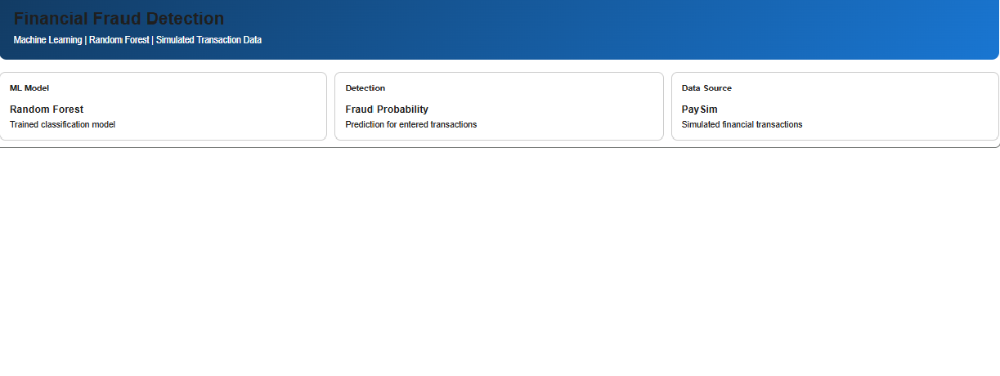

# Financial Fraud Detection Using Machine Learning

## Project Overview
This project analyzes simulated financial transactions and
builds machine learning models to identify transactions
labeled as potentially fraudulent.

The project compares rule-based detection, a Decision Tree,
and a Random Forest classifier, and includes an interactive
transaction prediction dashboard built in Google Colab.

## Objectives
- Explore financial transaction patterns.
- Analyze fraud-label distribution and transaction types.
- Engineer features using account balance changes.
- Train and compare machine learning classifiers.
- Build an interactive transaction scoring demonstration.

## Dataset
PaySim simulated financial transaction dataset.

The analysis uses a 10,000-row sample containing 11 columns:
- Transaction type and amount
- Sender and receiver account balances
- Fraud label and other transaction attributes

Dataset source:
https://www.kaggle.com/datasets/ealaxi/paysim1

## Tools and Technologies
- Python
- Pandas and NumPy
- Matplotlib
- Scikit-learn
- Joblib
- Google Colab
- Jupyter Notebook

## Models Compared

| Model | Accuracy | Precision | Recall | F1 Score |
|---|---:|---:|---:|---:|
| Decision Tree | 96.60% | 15.31% | 88.24% | 26.09% |
| Random Forest | 99.68% | 76.47% | 76.47% | 76.47% |

These metrics are from the current test split. The test set
contains only 17 fraud-labeled cases, so the results are
preliminary and have substantial uncertainty.

## Key Findings
- Fraud-labeled transactions represented 0.68% of the sample.
- In this sample, fraud labels appeared in TRANSFER and
  CASH_OUT transactions.
- Random Forest achieved a stronger balance of precision
  and recall than the Decision Tree on this test split.
- Accuracy alone is insufficient for evaluating fraud
  detection because the classes are imbalanced.

## Interactive Demonstration
The Google Colab dashboard accepts transaction details and
returns a model prediction and estimated fraud probability.

This is a simulated demonstration, not a live banking system.

## Limitations
- The dataset is simulated, not real banking transaction data.
- Analysis was performed on a 10,000-row sample.
- Only 17 fraud-labeled cases were present in the test set.
- Results do not establish performance on real-world data.
- Predictions should not be treated as verified fraud findings.

## Future Improvements
- Evaluate the model on a larger dataset.
- Use cross-validation and more extensive model tuning.
- Analyze precision-recall curves and probability calibration.
- Build a web interface for the demonstration.
- Test generalization on suitable independent data.

## Author
Data Analytics Portfolio Project

## Dashboard Preview

